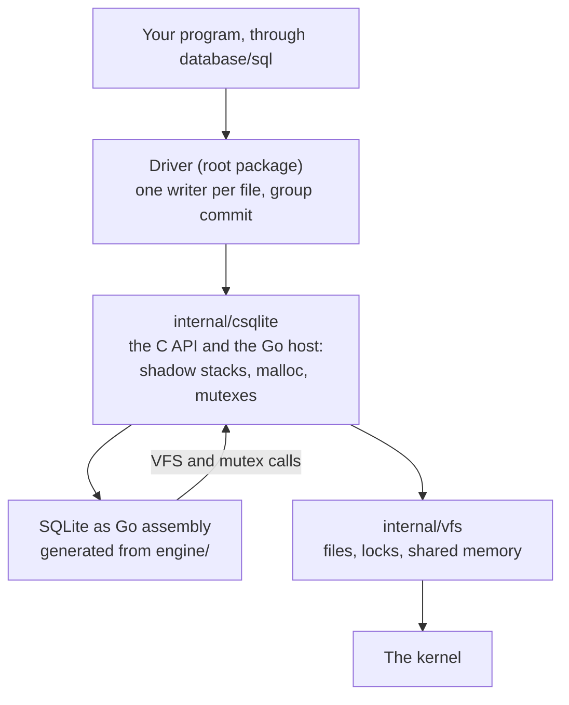
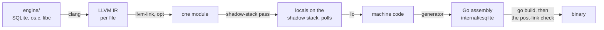
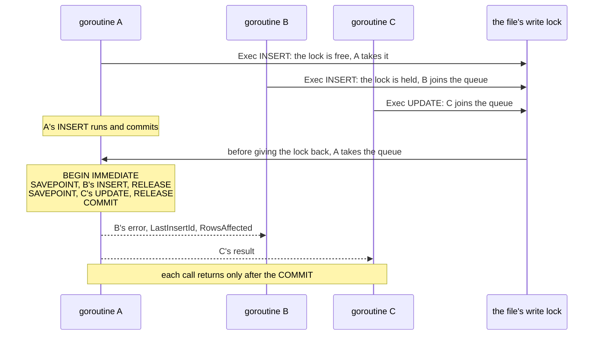

# Architecture

English · [简体中文](architecture.zh-CN.md)

## Layers

From the bottom up:

1. **The C tree** (`engine/`): the SQLite amalgamation as released, the compile options (`engine/sqlite.c`), a VFS and mutexes that call Go (`engine/os.c`, `engine/host.h`) and a small libc (`engine/libc/`). It is compiled freestanding, with no system headers.
2. **The generator** (`internal/goasm/gen/`): turns the C tree into Go assembly, one Go function per C function, and a Go file that declares them. Maintainers run it (`make gen`). Users never do.
3. **The engine package** (`internal/csqlite`): the generated Go assembly and its declarations, checked in, with the Go host beside them: shadow stacks, polls, malloc, mutexes, the callbacks of the VFS, and the small C API the driver calls.
4. **The files** (`internal/vfs`): pure Go, no engine. SQLite's file and lock rules on linux and darwin, as os_unix keeps them: the connections of one process to a database share one set of locks, kept apart from each other in memory, and the kernel is asked only when the process's lock changes. The kernel locks are OFD locks (locks that belong to an open file), so closing one connection never drops the locks of another. The `-shm` file is mapped for WAL. On windows the files and locks are those of os_win: each connection takes its `LockFileEx` locks on a handle of its own, and Windows keeps the locks of every handle apart, so the connections of one process exclude each other as processes do. The `-shm` is mapped with `CreateFileMapping`, a view per region, and each connection locks its slots on its own handle of it. The byte ranges are those of os_unix and os_win, so SQLite built from C can use a database at the same time.
5. **The driver** (the root package): `database/sql/driver` on top of that API, with one writer per database file and group commit.

## From C to Go assembly

`make gen` runs `scripts/gen-engine.sh`, which runs the generator over `engine/sqlite.c`, `engine/libc/string/*.c`, `engine/libc/math/*.c` and `engine/libc/math.c`:

1. clang compiles each file to LLVM IR with the flags of `engine/flags.sh` and the generator's own (target, frame pointer, no tail calls, registers Go keeps).
2. llvm-link joins the files, and the optimizer runs once more over the whole module.
3. The shadow-stack pass (`internal/goasm/gen/pass/`, an LLVM plugin) moves every local whose address is taken onto a stack of its own that the host gives, since Go's stack moves when it grows. It puts a poll in every loop, so that Go can stop the goroutine, and passes the extra arguments of a variadic call in a block on that stack.
4. llc writes the machine code. The generator rewrites each function as Go assembly: Go's prologue with its stack check, the arguments from Go's stack, each call made the way Go calls.
5. A check reads the linked binary and holds each function to what llc wrote.

SQLite needs no edit for this. SQLite 3.54.1 lowers whole on both targets: about 1900 functions with FTS5, R*Tree and the math functions, no stub, 14 MB of assembly in under a minute, and the post-link check passes on a linux/arm64 and a linux/amd64 binary.

### Writable data

SQLite keeps 33 writable globals: its configuration, the state of its allocator and page cache, the tables of built-in functions it links together at start. They are shared by the whole process, as a Go global is, so they go into the one Go data symbol with the read-only data, which is then written without RODATA. The read-only data of SQLite becomes writable memory with it. SQLite never writes it.

The lowering can only rewrite a reference to data that takes an address: a direct load would have to become a copy in the body of the function, which is wrong for data that changes. So the generator makes every writable global external and preemptible in the IR before llc runs (`ExposeWritableData`). Position-independent code then reaches each one only through a load of its address from the GOT, and the lowering turns that load into the address in the data symbol. x86 sometimes folds the load into a compare, an add or a subtract (`cmpq sym@GOTPCREL(%rip), %rdi`). For those globals the data symbol ends in an 8-byte slot holding the global's address, and the instruction reads the slot. A direct reference to writable data stops the build. `SQLITE_OMIT_WSD` was tried and does not fit: it leaves 21 of 33 globals writable (3.50.4), and makes each read of the configuration look it up.

A constant that holds pointers has the same problem when C copies it: a local array or struct with an initializer (FTS5's table of built-in tokenizers) is a memcpy from a constant, which llc turns into direct loads of it. The lowering cannot copy such a constant into the body, as its pointers need relocations, so the generator sends the constants that hold pointers and that a memcpy or memmove copies through the GOT as well (`ExposeCopiedPointerTables`). Every other constant is left alone.

## The Go host

A C function `host_x` declared in `engine/host.h` becomes a call of the Go function `host_x` of `internal/csqlite`, with the shadow pointer first. The generator knows them by the prefix.

- **Shadow stacks.** Each connection has a region of 32 MiB, aligned to its size and followed by a guard page, mapped with mmap and touched only as the C uses it. Windows has no mapping that holds no memory back, so there the region is reserved and committed with `VirtualAlloc`: it counts against the commit limit, and takes memory only as the C touches it. A call into the C passes a pointer into it. Strings and out-parameters of a call are written there too, so a call allocates nothing.
- **Polls.** The C calls `host_poll` every 10000 ticks of its loops. Its stack check is where the Go runtime can stop the goroutine.
- **Memory.** `malloc`, `realloc` and `free` are Go: size classes up to 256 KiB, each cut from spans of about 256 KiB mapped with mmap, and a mapping of its own above that. A span whose blocks are all free goes back to the system, except a few kept per size class for its next blocks. The garbage collector never sees SQLite's memory.
- **Threads.** SQLite runs in multi-thread mode: connections on many goroutines at once, each used by one at a time. `engine/os.c` installs mutexes that are Go `sync.Mutex` values (`SQLITE_CONFIG_MUTEX`, since SQLite 3.54 has no compile option for it).
- **Files.** `engine/os.c` is the VFS (named `go`). Each method calls `internal/vfs`.
- **Local time.** The `localtime` and `utc` modifiers call `localtime_r` in `engine/os.c`, which asks Go: the zone is `time.Local` (the `TZ` variable, or `/etc/localtime`). A program in an image without zone files gets UTC unless it imports `time/tzdata`.
- **Virtual tables.** A module written in Go (`WithModule`) is a `sqlite3_module` in `engine/os.c` whose methods call Go with the handle of the table or the cursor. A module made with `ModuleWritable` is a second `sqlite3_module` with `xUpdate` and the transaction methods. A write to one of its tables never merges: its Go code may keep state outside the database, which a batch that rolls back or another connection could not undo. `goClassify` looks the table up and marks such a statement as one that runs alone. Reading a Go table does not merge either, as in `INSERT INTO t SELECT ... FROM` one: each connection has its own instance of the table, which may give other rows than another connection's. SQLite puts a table it creates in the transaction without calling `xBegin`, so `xCreate` of a writable module calls it itself: every table that gets `xSync`, `xCommit` or `xRollback` had its `xBegin`. SQLite asks `xEof` after every row, so `engine/os.c` answers it from a field that Go sets after `Filter` and `Next`.
- **Go code that panics.** A function, an aggregate or a method of a virtual table that panics fails its statement, as an error would. A collation has no way to fail, so on a panic `engine/os.c` calls `sqlite3OomFault`, SQLite's own function for a failed allocation: SQLite stops the statement with `SQLITE_NOMEM` and rolls back the statement or the whole transaction, on the error path it tests for every allocation. The host reads two other internals of SQLite (below), from `engine/os.c`, which is compiled with `sqlite3.c`: `db->nVTrans`, and the links of a `Parse` to the statement it belongs to. A statement that writes and was running when another statement's error rolled its transaction back ends with an error, not with success (a rollback hook counts the rollbacks).

## Statements kept for queries

A query run without a `*sql.Stmt` (`Query`, `QueryRow`) keeps the statement it prepared on its connection, up to 64 a connection, and the next query of the same SQL there runs that statement again instead of preparing one (`cache.go`). While its rows are open the statement is not shared: the same SQL then gets a statement of its own. Only statements that read the main database are kept. A write is prepared each time: SQLite codes settings such as `foreign_keys` and `defer_foreign_keys` into a write as it prepares it, and does not always prepare it again when they change, so a kept write could skip a foreign key check. A PRAGMA, `ATTACH`, `EXPLAIN` or a read of another schema is prepared each time too, and a connection that prepares a statement that changes it (a PRAGMA that sets something, `ATTACH`, a temporary object) drops all it kept, whether the statement runs or not. After a change of the schema SQLite prepares a kept statement again by itself. Every rule is in [query-cache.md](query-cache.md).

This is what makes many readers fast. A `*sql.Stmt` takes the mutex of its `*sql.DB` at each query, even one prepared on a `*sql.Conn`, and with a few readers that mutex, not SQLite, sets the rate. A query on a `*sql.Conn` without a `Stmt` takes no lock the readers share, and with the statement kept it does not prepare again either.

## One writer per file

Inside the driver, a connection takes its file's write lock before a statement that may write (`sqlite3_stmt_readonly`), and gives it back once the connection is out of its transaction. Readers never take it. Without it, many writers of one process wait in SQLite's busy handler, whose sleeps grow (1, 2, 5 ms and up to 100 ms) while the writer that holds SQLite's lock waits for a thread: on an Apple M4, 64 goroutines that each insert one row took 1.7 ms per insert, and 12 µs with the lock. With cgo each call holds a thread of its own, which is why mattn/go-sqlite3 does not see this. A connection in a read transaction does not wait for the lock: it gets `SQLITE_BUSY` at once, as SQLite gives it then. In rollback journal mode the writer that holds the lock waits for that connection's read lock to go before it commits, so both would wait out the busy timeout. Writers of other processes still meet SQLite's own locks.

Readers still meet SQLite's locks in the default rollback journal mode: while a COMMIT holds the file locked, which lasts as long as its fsyncs, no connection can start a read, and SQLite's busy handler can miss every gap between commits that come back to back. With writes going on and a slow disk, a read, or the first statement of a new connection, can then wait the whole busy timeout and get `SQLITE_BUSY`. mattn/go-sqlite3 and modernc.org/sqlite do the same. In WAL mode readers never wait for writers: use it when a program reads while it writes.

## When a sync of the WAL fails

When an fsync fails, Linux marks the pages it could not write clean. They still read back from memory and the next fsync succeeds, but once the kernel drops them they read back as the disk holds them. With `synchronous=NORMAL`, SQLite syncs the WAL only when it checkpoints, so after that sync fails, the next checkpoint copies frames that may not be on disk into the database. SQLite's own VFS lets it, and the database is damaged once the pages are dropped.

So on linux and darwin, the first failed sync of a WAL stops it in the process:

- The WAL is cut at the first byte written since its last good sync. This removes the frames that may not be on disk, from the file and from memory. Writes and syncs of one WAL never overlap, so the cut never takes a commit another sync already made durable.
- Every read, write and sync of the WAL then fails, and no connection can open it.
- `database/sql` drops each connection of that database (main or attached) when it takes it from its pool or gives it back (`IsValid`). Connections of other databases are not touched.
- The WAL opens again once no connection of the process has it open and no other process has the database open. The next connection then rebuilds the WAL index from the frames on disk. While another process has it open, the index it shares still counts the frames cut, and a writer would write past them, so the WAL stays stopped.
- When the cut itself fails, nothing can make the WAL sound, and it stays stopped until the process ends.
- The replicator closes its connections at its next step and stages a full copy.

The cost: with `synchronous=NORMAL`, what was committed since the last good sync of the WAL is lost, as on a power loss. With `synchronous=FULL` nothing told committed is lost, since a commit whose sync failed never joined the WAL. Until the WAL opens again, every call on the database fails. A connection that no one takes keeps it stopped: a `sql.Conn` or `sql.Tx` the program keeps open, or the idle connections of another `sql.DB` of the same file that gets no calls. `SetConnMaxIdleTime` lets `database/sql` close such idle connections. Another process is not stopped, and on windows SQLite's own behavior is kept.

## Group commit

Many goroutines that each write one row in autocommit mode each pay for a commit, and with one writer at a time in SQLite they wait for each other. The driver takes the autocommit DML of many callers, runs it as one transaction and commits once. The rules are in [AGENTS.md](../AGENTS.md#hard-constraints): only autocommit DML on the main database, a SAVEPOINT per statement, each caller its own result, and the call returns only after the commit.

How it works (`writer.go`): a statement that comes to the file's write lock while another connection holds it joins the file's queue instead of waiting. The connection that gives the lock back runs the queue on itself, up to 256 statements: `BEGIN IMMEDIATE`, then each statement between `SAVEPOINT` and `RELEASE`, then `COMMIT`, and only then does each caller get its result. A statement that fails keeps what SQLite kept of it, as it would alone (nothing, or the rows before the failure for `OR FAIL`), and its caller gets the error after the commit. A statement that leaves a deferred foreign key unresolved, one that failed too, is undone with `ROLLBACK TO`, and its caller gets the error its own `COMMIT` would have given. No statement runs twice. When a failure ends the whole transaction (an interrupt from a context that ended, an IO error, `ON CONFLICT ROLLBACK`), its caller gets that error, the statements that had run before it, those that failed too, get `SQLITE_ABORT_ROLLBACK` over it, and the statements after it, which never reached SQLite, go back to the queue. A Go function may act outside the database, which no rollback undoes, so a statement that called a Go function not marked `Innocuous` (scalar, aggregate or window) ends the batch: it commits right after it, and the statements after it wait for the next batch. A call of such a function marks the connection (`markEffects`), so it is found as it happens, also from a trigger. FTS5 writes the terms of an `INSERT` to its index only at the next `SAVEPOINT` or at `COMMIT`, so once a virtual table takes part in the transaction (`db->nVTrans`), each statement is followed by a `SAVEPOINT` and `RELEASE` of its own, inside its own `SAVEPOINT`: a failure to write the index (a broken index, a full disk) is then the statement's, as it would be alone, and not the next one's, and the statement is undone. Statements are sorted as they are prepared by an authorizer (`goClassify` in `engine/os.c`), which also sees the statements SQLite prepares meanwhile: R*Tree prepares writes of its shadow tables when a connection first uses one. What they do is not the statement's: they never mark it as a write of the main database. They may still make it unmergeable, which is only slower. The body of a trigger is coded in a `Parse` of its own too, whose `pToplevel` is its statement, and it counts: a `Parse` is nested when the statement at its top has a `pOuterParse`. A caller whose context is done before its turn gets the context's error and its statement never runs. After the batch the lock goes to whichever came first of the next connection that waits for it and the first statement of the queue, and when it goes to a statement, that statement runs on its own connection. The lock is handed on in the order they came, so a statement no batch can take (no connection that gives the lock back can run it: it belongs to another connector, or those connections changed themselves) still gets its turn. With no other writer a statement runs directly, so one writer pays nothing. Every rule, and who gets what error at each step, is in [group-commit.md](group-commit.md).

Which statements may join: the driver installs an authorizer in C (`goClassify` in `engine/os.c`) that sees each statement as it is prepared. A statement joins only when it writes tables of the main database and touches nothing only its own connection has: no other schema (temp, attached), no write from a trigger (it may be a temporary trigger), no write to a table of a writable Go module, no read of a table of any Go module, no `last_insert_rowid()`, `changes()` or `total_changes()`, and nothing that is not DML. Only `Exec` merges. A statement in a transaction never does. A change of the schema can make a statement unmergeable after it was prepared (a new trigger, a table that became a Go table), and SQLite then prepares it again inside `sqlite3_step`, before it does anything. On a connection that runs a batch, the authorizer refuses that new program when it is no longer mergeable: the statement fails having done nothing and goes back to run on its caller's connection. A statement SQLite prepared again is sorted again before it next asks to merge.

Which connections may run each other's statements: only connections of one connector (the same DSN, so the same `_pragma` settings), and only while neither has changed itself since it opened. A connection changes itself with a PRAGMA that sets something, `ATTACH`, `DETACH` or a temporary table, view, index or trigger, and the authorizer marks it as the statement is prepared. A connection opened read-only, one whose DSN turns `defer_foreign_keys` on (SQLite turns it off at the end of each transaction, so connections of one DSN differ), and one in a read-only transaction never merge either, nor one with a query not done: it keeps the snapshot it read, which another connection would not have. From then on the connection writes only on its own, with the file's write lock as before. Functions, aggregates, collations and virtual table modules written in Go are part of the connector: one made with options of its own (`NewConnector(dsn, opts...)`) has a key no other connector shares, and connectors made after the same `Register` calls share one. So the connection that runs a merged statement always has the functions its caller has.

One thing differs from running alone: a merged statement runs on another connection, so `changes()` and `total_changes()` on the caller's connection do not count it, and the connection that ran it counts it instead. `LastInsertId` and `RowsAffected` are right, and so is `last_insert_rowid()` on the caller's connection.

On an Apple M4 (WAL, `synchronous=NORMAL`, one autocommit `INSERT` per call, `bench/`), the time per insert:

| Writers | mattn (cgo) | this driver |
| --- | --- | --- |
| 1 | 9.7 µs | 9.1 µs |
| 8 | 9.0 µs | 3.4 µs |
| 64 | 16.8 µs | 1.4 µs |

More drivers and linux are in [benchmarks.md](benchmarks.md).

A prototype of it in application code, on mattn/go-sqlite3 (WAL, one writer goroutine taking whatever callers are waiting, up to 256), measured on an Apple M4:

| Writers | synchronous | One commit per write | Group commit | Gain |
| --- | --- | --- | --- | --- |
| 1 | NORMAL | 133k writes/s | 88k writes/s | 0.7x |
| 16 | NORMAL | 88k | 197k | 2.2x |
| 256 | NORMAL | 94k | 359k | 3.8x |
| 16 | FULL, fullfsync | 213 | 2.0k | 9.5x |
| 256 | FULL, fullfsync | 150 | 34.8k | 232x |

So it pays from about 16 concurrent writers up, most where a commit waits for the disk, and costs with one writer, where the queue only adds a hop: the driver must write directly when no one else is waiting. One commit per write is also unfair: some goroutines waited seconds and some got `SQLITE_BUSY`. The SAVEPOINT per statement halves the peak (it adds two calls per statement in the prototype). A failed constraint in SQLite already undoes only its own statement, so where the SAVEPOINT is really needed has yet to be shown. It stays all the same: safety comes before speed. Each run took 3 seconds once, and runs of the same setup differed by up to 90%, so read gains under 1.5x as noise.

## Replication

The `replica` package copies a database to S3-compatible storage as it changes. How to use it and what it guarantees is in [replication.md](replication.md). It has four parts:

| Package | Job |
| --- | --- |
| `internal/replhook` | What the driver gives the replicator and not its users: a file attached for replication, the driver's write lock of it, and a call each time a writer gives that lock back |
| `replica/internal/capture` | Copies each change of the database into a local staging folder as an LTX file, and runs the checkpoints |
| `replica/internal/s3` | The S3 client: SigV4, PUT, multipart upload, ranged GET, LIST, DELETE, conditional PUT. No dependencies |
| `replica` | The API: uploads, compaction, snapshots, retention, restore |

**Capture inside the driver.** Litestream follows a database from outside: it reads the WAL every second, holds a long read transaction so that no checkpoint runs past it, and works out from salts and the last page what other connections did. Its open bugs that lose or damage data come from that guessing (a transaction that never committed replicated, a WAL rewound by a power loss not seen, rows dropped after a checkpoint it did not run). Here the driver owns every connection to the file, so the replicator does not guess:

- An attached file gets no automatic checkpoints, and the PRAGMAs that would checkpoint or leave WAL mode give an error.
- The capturer reads the new frames of the WAL up to the last commit frame, checking salts and frame checksums as SQLite's recovery does, writes them as one LTX file, and syncs it before it counts as staged. Frames after the last commit are never read.
- Checkpoints run under the driver's write lock of the file, after the WAL is staged to its end, so no frame is copied into the database or written over before it is staged. Once the WAL holds 4000 frames, the writer that gives the lock back stages and checkpoints, as SQLite's own automatic checkpoint runs in the writer that commits.
- A WAL that went on in a way the driver did not make (other salts, a shorter WAL, frames it never saw) means another process wrote: the capturer stages a full copy of the database and reports it.
- A snapshot takes the write lock only to stage the WAL and open a read transaction, then reads the pages without stopping writers.

**Upload from the staging folder.** Writes never wait for the store. Each LTX file is uploaded once, with `If-None-Match: *`, so a second replicator gets 412 and stops instead of writing over the first. At start the replicator reads where the replica ends and goes on only when the staged files go on from there. Staging has a limit: past it, staging stops, checkpoints go on, and a full copy follows once the store is back, so a store that is down does not make the disk or the WAL grow without end.

**Litestream's format.** The replica is LTX files (github.com/superfly/ltx) in Litestream's layout, so `litestream restore` is a second way back, and the tests check that it gives the same bytes. LTX files carry a checksum of the whole database before and after them, which Litestream leaves off and this replicator turns on: a restore checks the database after every file it applies, not only after the last.

**Left out on purpose.** Client-side encryption (`litestream restore` could not read the replica). Other storage than S3. Synchronous replication, where a commit returns once it is in the store: the driver already calls the replicator each time a writer gives the lock back, so it can come later, paid once per group commit batch. A fence that keeps a second machine out: S3 has none, see [replication.md](replication.md#one-replicator-per-replica).

## Making the engine faster

The engine is slower than the same C built by clang: on an Apple M4, work inside the engine takes 1.16 to 1.57 times as long (see [benchmarks.md](benchmarks.md#against-sqlite-in-c)). Part of it is the price of the route itself. liustack/quickjs, which compiles its C the same way, measured 11 to 13% for the same C with the same options, from arguments and results passed on the Go stack, address-taken locals on the shadow stack, and a few more instructions per call. Work to win some of it back follows what quickjs learned from the many routes it tried and left:

- **Nothing private to Go.** No `go:linkname` into the runtime, no reliance on how Go uses a register, nothing the Go team may change in a release. Each Go version would have to be checked again, and one could break the driver.
- **The engine stays on the goroutine stack.** Running it on a stack of its own, as cgo, wazero and purego do, would turn a fault in the C into the end of the whole process instead of a panic of one call.
- **No gain below the noise.** A change that saves less than where the code happens to land in memory moves a run (2 to 3%) is not taken, however clean.
- **The same bits on every target.** The math functions stay without fused multiply-add, so every platform gives the same result.
- **SQLite's C stays as released.** Changes go in the generator, `engine/libc` or the Go host.

quickjs keeps the same rules, with the reasons it learned them: [Making the engine faster](https://github.com/liustack/quickjs/blob/main/docs/architecture.md#making-the-engine-faster). Before trying an idea, check the lists of what quickjs tried and did not do: [performance.md](https://github.com/liustack/quickjs/blob/main/docs/performance.md#what-was-tried-and-not-done) and [history.md](https://github.com/liustack/quickjs/blob/main/docs/history.md#what-was-tried-and-not-done-on-the-old-engine).

## Routes left out

- **cgo** (mattn/go-sqlite3): needs a C compiler for every build and every target, and cross-compiling is hard. Not having to do this is the reason for the project.
- **C translated to Go** (modernc.org/sqlite, made with ccgo): no cgo, but slower than cgo: 1.2 to 1.4 times as long as cgo on a point read and 1.6 to 2.4 times on a join (see [benchmarks.md](benchmarks.md)). slowjs went this way for QuickJS before and left it for the same reason.
- **WebAssembly** (ncruces/go-sqlite3): SQLite compiled to wasm, which wasm2go translates to Go. No cgo, but the C passes through a second machine model on its way to the CPU.
- **A shared library loaded with purego**: no single static binary, the SQLite version depends on the system, and each call costs more.
