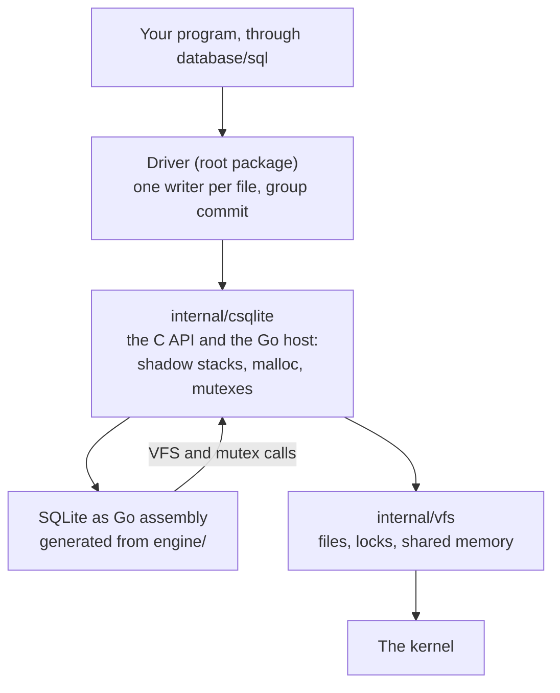
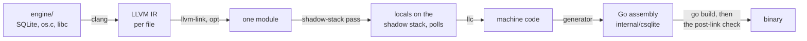
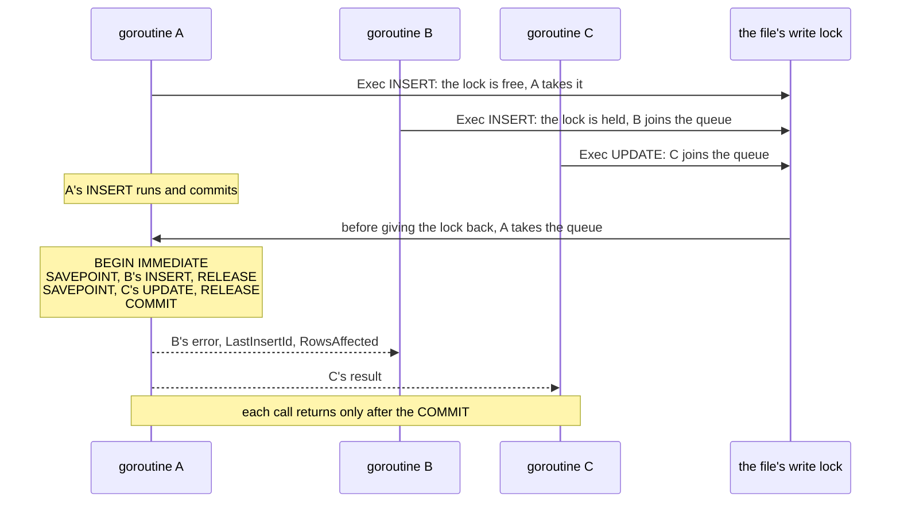

# Architecture

English · [简体中文](architecture.zh-CN.md)

## Layers

From the bottom up:

1. **The C tree** (`engine/`): the SQLite amalgamation as released, the compile options (`engine/sqlite.c`), a VFS and mutexes that call Go (`engine/os.c`, `engine/host.h`) and a small libc (`engine/libc/`). It is compiled freestanding, with no system headers.
2. **The generator** (`internal/goasm/gen/`): turns the C tree into Go assembly, one Go function per C function, and a Go file that declares them. Maintainers run it (`make gen`). Users never do.
3. **The engine package** (`internal/csqlite`): the generated Go assembly and its declarations, checked in, with the Go host beside them: shadow stacks, polls, malloc, mutexes, the callbacks of the VFS, and the small C API the driver calls.
4. **The files** (`internal/vfs`): pure Go, no engine. SQLite's file and lock rules on linux and darwin, as os_unix keeps them: the connections of one process to a database share one set of locks, kept apart from each other in memory, and the kernel is asked only when the process's lock changes. The kernel locks are OFD locks (locks that belong to an open file), so closing one connection never drops the locks of another. The `-shm` file is mapped for WAL.
5. **The driver** (the root package): `database/sql/driver` on top of that API, with one writer per database file and group commit.

## From C to Go assembly

`make gen` runs `scripts/gen-engine.sh`, which runs the generator over `engine/sqlite.c` and `engine/libc/string/*.c`:

1. clang compiles each file to LLVM IR with the flags of `engine/flags.sh` and the generator's own (target, frame pointer, no tail calls, registers Go keeps).
2. llvm-link joins the files, and the optimizer runs once more over the whole module.
3. The shadow-stack pass (`internal/goasm/gen/pass/`, an LLVM plugin) moves every local whose address is taken onto a stack of its own that the host gives, since Go's stack moves when it grows. It puts a poll in every loop, so that Go can stop the goroutine, and passes the extra arguments of a variadic call in a block on that stack.
4. llc writes the machine code. The generator rewrites each function as Go assembly: Go's prologue with its stack check, the arguments from Go's stack, each call made the way Go calls.
5. A check reads the linked binary and holds each function to what llc wrote.

SQLite needs no edit for this. SQLite 3.54.1 lowers whole on both targets: about 1460 functions, no stub, 10 MB of assembly in under a minute, and the post-link check passes on a linux/arm64 and a linux/amd64 binary.

### Writable data

SQLite keeps 31 writable globals: its configuration, the state of its allocator and page cache, the tables of built-in functions it links together at start. They are shared by the whole process, as a Go global is, so they go into the one Go data symbol with the read-only data, which is then written without RODATA. The read-only data of SQLite becomes writable memory with it. SQLite never writes it.

The lowering can only rewrite a reference to data that takes an address: a direct load would have to become a copy in the body of the function, which is wrong for data that changes. So the generator makes every writable global external and preemptible in the IR before llc runs (`ExposeWritableData`). Position-independent code then reaches each one only through a load of its address from the GOT, and the lowering turns that load into the address in the data symbol. x86 sometimes folds the load into a compare, an add or a subtract (`cmpq sym@GOTPCREL(%rip), %rdi`). For those globals the data symbol ends in an 8-byte slot holding the global's address, and the instruction reads the slot. A direct reference to writable data stops the build. `SQLITE_OMIT_WSD` was tried and does not fit: it leaves 21 of 33 globals writable (3.50.4), and makes each read of the configuration look it up.

## The Go host

A C function `host_x` declared in `engine/host.h` becomes a call of the Go function `host_x` of `internal/csqlite`, with the shadow pointer first. The generator knows them by the prefix.

- **Shadow stacks.** Each connection has a region of 32 MiB, aligned to its size and followed by a guard page, mapped with mmap and touched only as the C uses it. A call into the C passes a pointer into it. Strings and out-parameters of a call are written there too, so a call allocates nothing.
- **Polls.** The C calls `host_poll` every 10000 ticks of its loops. Its stack check is where the Go runtime can stop the goroutine.
- **Memory.** `malloc`, `realloc` and `free` are Go: size classes up to 256 KiB cut from 4 MiB mmap arenas, a mapping of its own above that. The garbage collector never sees SQLite's memory.
- **Threads.** SQLite runs in multi-thread mode: connections on many goroutines at once, each used by one at a time. `engine/os.c` installs mutexes that are Go `sync.Mutex` values (`SQLITE_CONFIG_MUTEX`, since SQLite 3.54 has no compile option for it).
- **Files.** `engine/os.c` is the VFS (named `go`). Each method calls `internal/vfs`.
- **Local time.** The `localtime` and `utc` modifiers call `localtime_r` in `engine/os.c`, which asks Go: the zone is `time.Local` (the `TZ` variable, or `/etc/localtime`). A program in an image without zone files gets UTC unless it imports `time/tzdata`.

## One writer per file

Inside the driver, a connection takes its file's write lock before a statement that may write (`sqlite3_stmt_readonly`), and gives it back once the connection is out of its transaction. Readers never take it. Without it, many writers of one process wait in SQLite's busy handler, whose sleeps grow (1, 2, 5 ms and up to 100 ms) while the writer that holds SQLite's lock waits for a thread: on an Apple M4, 64 goroutines that each insert one row took 1.7 ms per insert, and 12 µs with the lock. With cgo each call holds a thread of its own, which is why mattn/go-sqlite3 does not see this. Writers of other processes still meet SQLite's own locks.

## Group commit

Many goroutines that each write one row in autocommit mode each pay for a commit, and with one writer at a time in SQLite they wait for each other. The driver takes the autocommit DML of many callers, runs it as one transaction and commits once. The rules are in [AGENTS.md](../AGENTS.md#hard-constraints): only autocommit DML on the main database, a SAVEPOINT per statement, each caller its own result, and the call returns only after the commit.

How it works (`writer.go`): a statement that comes to the file's write lock while another connection holds it joins the file's queue instead of waiting. The connection that gives the lock back runs the queue on itself, up to 256 statements: `BEGIN IMMEDIATE`, then each statement between `SAVEPOINT` and `RELEASE`, then `COMMIT`, and only then does each caller get its result. A statement that fails keeps what SQLite kept of it, as it would alone (nothing, or the rows before the failure for `OR FAIL`), and its caller gets the error. A statement that leaves a deferred foreign key unresolved is undone with `ROLLBACK TO`, and its caller gets the error its own `COMMIT` would have given. When a failure ends the whole transaction, the statements that had run are run again in a new one. A caller whose context is done before its turn gets the context's error and its statement never runs. After the batch the lock goes to the next connection that waits for it, or else to the first statement of the queue, which then runs on its own connection: no one waits behind the queue for long. With no other writer a statement runs directly, so one writer pays nothing.

Which statements may join: the driver installs an authorizer in C (`goClassify` in `engine/os.c`) that sees each statement as it is prepared. A statement joins only when it writes tables of the main database and touches nothing only its own connection has: no other schema (temp, attached), no write from a trigger (it may be a temporary trigger), no `last_insert_rowid()`, `changes()` or `total_changes()`, and nothing that is not DML. Only `Exec` merges. A statement in a transaction never does.

Which connections may run each other's statements: only connections of one connector (the same DSN, so the same `_pragma` settings), and only while neither has changed itself since it opened. A connection changes itself with a PRAGMA that sets something, `ATTACH`, `DETACH` or a temporary table, view, index or trigger, and the authorizer marks it as the statement is prepared. A connection opened read-only, and one in a read-only transaction, never merge either. From then on the connection writes only on its own, with the file's write lock as before. Functions, aggregates and collations written in Go are part of the connector: one made with options of its own (`NewConnector(dsn, opts...)`) has a key no other connector shares, and connectors made after the same `Register` calls share one. So the connection that runs a merged statement always has the functions its caller has.

One thing differs from running alone: a merged statement runs on another connection, so `changes()` and `total_changes()` on the caller's connection do not count it, and the connection that ran it counts it instead. `LastInsertId` and `RowsAffected` are right, and so is `last_insert_rowid()` on the caller's connection.

On an Apple M4 (WAL, `synchronous=NORMAL`, one autocommit `INSERT` per call, `bench/`), the time per insert:

| Writers | mattn (cgo) | this driver |
| --- | --- | --- |
| 1 | 9.7 µs | 9.1 µs |
| 8 | 9.0 µs | 3.4 µs |
| 64 | 16.8 µs | 1.4 µs |

More drivers and linux are in [benchmarks.md](benchmarks.md).

A prototype of it in application code, on mattn/go-sqlite3 (WAL, one writer goroutine taking whatever callers are waiting, up to 256), measured on an Apple M4:

| Writers | synchronous | One commit per write | Group commit | Gain |
| --- | --- | --- | --- | --- |
| 1 | NORMAL | 133k writes/s | 88k writes/s | 0.7x |
| 16 | NORMAL | 88k | 197k | 2.2x |
| 256 | NORMAL | 94k | 359k | 3.8x |
| 16 | FULL, fullfsync | 213 | 2.0k | 9.5x |
| 256 | FULL, fullfsync | 150 | 34.8k | 232x |

So it pays from about 16 concurrent writers up, most where a commit waits for the disk, and costs with one writer, where the queue only adds a hop: the driver must write directly when no one else is waiting. One commit per write is also unfair: some goroutines waited seconds and some got `SQLITE_BUSY`. The SAVEPOINT per statement halves the peak (it adds two calls per statement in the prototype). A failed constraint in SQLite already undoes only its own statement, so where the SAVEPOINT is really needed has yet to be shown. It stays all the same: safety comes before speed. Each run took 3 seconds once, and runs of the same setup differed by up to 90%, so read gains under 1.5x as noise.

## Routes left out

- **cgo** (mattn/go-sqlite3): needs a C compiler for every build and every target, and cross-compiling is hard. Not having to do this is the reason for the project.
- **C translated to Go** (modernc.org/sqlite, made with ccgo): no cgo, but slower than cgo: 1.2 to 1.4 times as long as cgo on a point read and 1.6 to 2.4 times on a join (see [benchmarks.md](benchmarks.md)). slowjs went this way for QuickJS before and left it for the same reason.
- **WebAssembly** (ncruces/go-sqlite3): SQLite compiled to wasm, which wasm2go translates to Go. No cgo, but the C passes through a second machine model on its way to the CPU.
- **A shared library loaded with purego**: no single static binary, the SQLite version depends on the system, and each call costs more.
