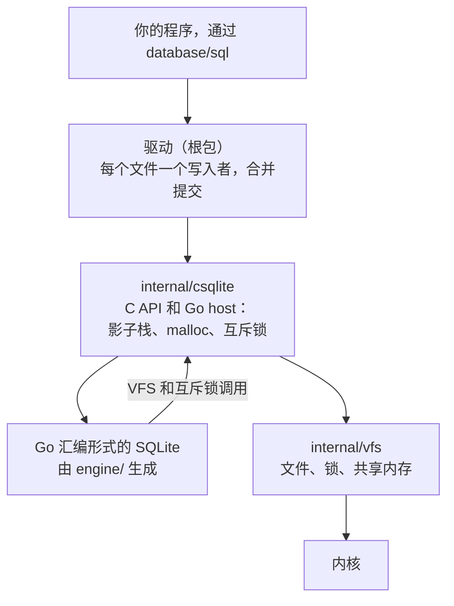
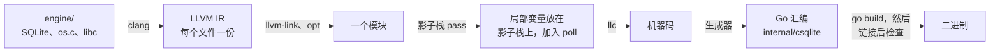
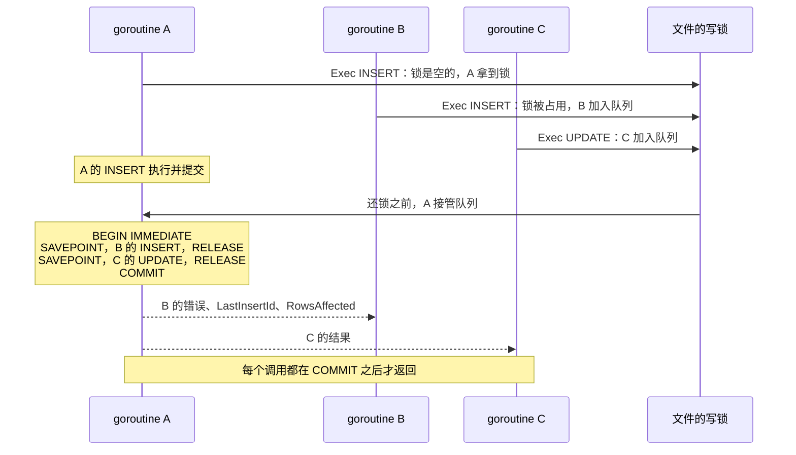

# 架构

[English](architecture.md) · 简体中文

## 分层

从下往上：

1. **C 树**（`engine/`）：发布原样的 SQLite amalgamation、编译选项（`engine/sqlite.c`）、调用 Go 的 VFS 和互斥锁（`engine/os.c`、`engine/host.h`），以及一个小 libc（`engine/libc/`）。它按 freestanding 方式编译，不用系统头文件。
2. **生成器**（`internal/goasm/gen/`）：把 C 树变成 Go 汇编，每个 C 函数对应一个 Go 函数，再加一个声明它们的 Go 文件。由维护者运行（`make gen`），用户不用跑。
3. **引擎包**（`internal/csqlite`）：生成的 Go 汇编和它的声明，都提交进仓库，旁边是 Go host：影子栈、poll、malloc、互斥锁、VFS 的回调，以及驱动调用的那一小组 C API。
4. **文件层**（`internal/vfs`）：纯 Go，不含引擎。在 linux 和 darwin 上实现 SQLite 的文件和锁规则，做法和 os_unix 一样：同一进程里连到同一个数据库的各个连接共享一套锁，这些锁在内存里彼此分开，只有进程持有的锁发生变化时才去问内核。内核锁用 OFD 锁（属于打开文件的锁），所以关掉一个连接不会放掉别的连接的锁。`-shm` 文件为 WAL 做了内存映射。在 windows 上，文件和锁的做法和 os_win 一样：每个连接在自己的句柄上用 `LockFileEx` 加锁，Windows 把每个句柄的锁分开算，所以同一进程的连接像不同进程一样互斥。`-shm` 用 `CreateFileMapping` 映射，每个区域一个视图，每个连接在自己的 `-shm` 句柄上锁槽位。锁的字节范围和 os_unix、os_win 一样，所以 C 编译的 SQLite 可以同时用同一个库。
5. **驱动**（根包）：在这套 API 之上实现 `database/sql/driver`，每个数据库文件一个写入者，并带合并提交。

## 从 C 到 Go 汇编

`make gen` 运行 `scripts/gen-engine.sh`，它让生成器处理 `engine/sqlite.c`、`engine/libc/string/*.c`、`engine/libc/math/*.c` 和 `engine/libc/math.c`：

1. clang 用 `engine/flags.sh` 的参数和生成器自己的参数（目标平台、帧指针、不做尾调用、保留 Go 用的寄存器）把每个文件编译成 LLVM IR。
2. llvm-link 把这些文件合在一起，优化器再对整个模块跑一遍。
3. 影子栈 pass（`internal/goasm/gen/pass/`，一个 LLVM 插件）把每个被取过地址的局部变量搬到 host 提供的一块独立的栈上，因为 Go 的栈在增长时会移动。它在每个循环里放一个 poll，好让 Go 能中止这个 goroutine，还把可变参数调用的额外参数放在这个栈上的一块内存里传递。
4. llc 生成机器码。生成器把每个函数改写成 Go 汇编：用 Go 的函数序言和它的栈检查，参数从 Go 的栈上取，每次调用都按 Go 的方式发出。
5. 一道检查会读取链接好的二进制，保证每个函数都和 llc 写出的一致。

这个过程不需要改 SQLite。SQLite 3.54.1 在两个目标平台上都能整个降级成功：连同 FTS5、R*Tree 和数学函数大约 1900 个函数，没有桩函数，14 MB 汇编，一分钟内完成，链接后检查在 linux/arm64 和 linux/amd64 的二进制上都通过。

### 可写数据

SQLite 有 33 个可写的全局变量：它的配置、分配器和页缓存的状态，还有启动时串起来的内置函数表。它们和 Go 的全局变量一样由整个进程共享，所以和只读数据一起放进那一个 Go 数据符号，这个符号不带 RODATA 来写。SQLite 的只读数据也因此变成了可写内存，但 SQLite 从不写它们。

降级只能改写那些取地址的数据引用：直接 load 要变成函数体里的一份拷贝，对会变化的数据来说这是错的。所以生成器在 llc 运行前，先在 IR 里把每个可写全局变量改成 external 和 preemptible（`ExposeWritableData`）。这样位置无关代码只能通过 GOT 加载它的地址来访问每一个，降级再把这次加载换成数据符号里的地址。x86 有时会把这次加载并进比较、加法或减法里（`cmpq sym@GOTPCREL(%rip), %rdi`）。对这些全局变量，数据符号的末尾放一个 8 字节的槽，里面存全局变量的地址，指令读的是这个槽。直接引用可写数据会让构建失败。试过 `SQLITE_OMIT_WSD`，但不合适：它让 33 个全局变量里仍有 21 个可写（3.50.4），而且每次读配置都要查一次。

含指针的常量被 C 拷贝时也有同样的问题：带初值的局部数组或结构体（FTS5 的内置分词器表）是从一个常量 memcpy 过来的，llc 会把它展开成对这个常量的直接 load。降级没法把这样的常量拷进函数体，因为里面的指针要重定位，所以生成器把含指针、又被 memcpy 或 memmove 拷贝的常量也改成走 GOT（`ExposeCopiedPointerTables`）。其他常量不动。

## Go host

`engine/host.h` 里声明的 C 函数 `host_x`，会变成对 `internal/csqlite` 里 Go 函数 `host_x` 的调用，影子指针放在第一个参数。生成器靠前缀认出它们。

- **影子栈。** 每个连接有一块 32 MiB 的区域，按自身大小对齐，后面跟一个保护页，用 mmap 映射，C 用到哪里才碰到哪里。Windows 没有不预留内存的映射，所以在 windows 上用 `VirtualAlloc` 保留并提交整块：它计入提交上限，但 C 碰到哪里才真正占用内存。调用 C 时传入指向它的指针。调用的字符串和输出参数也写在这里，所以一次调用不分配任何内存。
- **Poll。** C 的循环每走 10000 个 tick 调用一次 `host_poll`。它的栈检查就是 Go 运行时能中止这个 goroutine 的地方。
- **内存。** `malloc`、`realloc` 和 `free` 都是 Go 写的：256 KiB 以内的大小分档，每档从约 256 KiB 的 mmap 区块里切，超过的各自单独映射。块全部释放的区块还给系统，每档只留几个空区块备用。垃圾回收器看不到 SQLite 的内存。
- **线程。** SQLite 以多线程模式运行：许多 goroutine 上同时有连接，但每个连接同一时刻只由一个 goroutine 使用。`engine/os.c` 安装的互斥锁是 Go 的 `sync.Mutex`（用 `SQLITE_CONFIG_MUTEX`，因为 SQLite 3.54 没有对应的编译选项）。
- **文件。** `engine/os.c` 就是 VFS（名字叫 `go`）。它的每个方法都调用 `internal/vfs`。
- **本地时间。** `localtime` 和 `utc` 修饰符调用 `engine/os.c` 里的 `localtime_r`，它去问 Go：时区就是 `time.Local`（`TZ` 环境变量，或者 `/etc/localtime`）。镜像里没有时区文件时得到 UTC，除非程序 import 了 `time/tzdata`。
- **虚拟表。** Go 写的模块（`WithModule`）在 `engine/os.c` 里是一个 `sqlite3_module`，它的方法带着表或游标的句柄调用 Go。用 `ModuleWritable` 创建的模块是另一个 `sqlite3_module`，带 `xUpdate` 和事务方法。写它的表的语句从不合并：它的 Go 代码可能在数据库之外留状态，批次重跑或换个连接执行都撤不回来。`goClassify` 查到这张表，就把语句标成单独执行。读 Go 表的语句也不合并，比如从它 `INSERT INTO t SELECT ... FROM`：每个连接有自己的表实例，给出的行可能和别的连接不同。SQLite 把刚建的表放进事务时不调 `xBegin`，所以可写模块的 `xCreate` 自己调一次：收到 `xSync`、`xCommit` 或 `xRollback` 的表都先收到过 `xBegin`。SQLite 每读一行都要问一次 `xEof`，所以 `engine/os.c` 直接用 Go 在 `Filter` 和 `Next` 之后设好的字段回答。
- **Go 代码 panic。** 函数、聚合或虚拟表的方法 panic 时，和返回错误一样，让它所在的语句失败。排序规则没有办法报错，所以 panic 时 `engine/os.c` 调用 `sqlite3OomFault`，这是 SQLite 自己记录内存分配失败的函数：SQLite 以 `SQLITE_NOMEM` 中止语句，回滚这条语句或整个事务，走的是它对每次内存分配都测过的错误路径。宿主另外还读 SQLite 的两处内部实现（见下文），在和 `sqlite3.c` 一起编译的 `engine/os.c` 里：`db->nVTrans`，以及 `Parse` 指向它所属语句的链接。一条写语句正在执行时，如果别的语句出错把它的事务回滚了，它结束时报错，不报成功（用回滚钩子计数）。

## 查询的语句留着复用

不经过 `*sql.Stmt` 的查询（`Query`、`QueryRow`）会把它编译好的语句留在自己的连接上，每条连接最多 64 条。同一条连接上再来同样的 SQL，就直接再跑这条语句，不再编译（`cache.go`）。语句的结果集还开着时不共用：这时同样的 SQL 另外编译一条。只留只读主库的语句。写语句每次都重新编译：SQLite 编译写语句时会把 `foreign_keys`、`defer_foreign_keys` 这类设置编进去，设置变了也不一定让它重新编译，留着的写语句就可能跳过外键检查。PRAGMA、`ATTACH`、`EXPLAIN`、读其他 schema 的语句也每次重新编译。连接一旦编译了会改变自己的语句（设置某项的 PRAGMA、`ATTACH`、临时对象），不管执行没有，留着的语句全部丢掉。schema 变了以后，SQLite 会自己重新编译留着的语句。全部规则见 [query-cache.zh-CN.md](query-cache.zh-CN.md)。

很多读者能跑快靠的就是这个。`*sql.Stmt` 每次查询都要拿它所属 `*sql.DB` 的互斥锁，在 `*sql.Conn` 上编译的也一样，读者一多，限住速度的就是这把锁，不是 SQLite。在 `*sql.Conn` 上不用 `Stmt` 查询，不碰读者之间共用的锁，语句又留着，也不用再编译。

## 每个文件一个写入者

在驱动内部，一个连接执行可能写入的语句之前（`sqlite3_stmt_readonly`）先拿这个文件的写锁，等连接结束事务后再还回去。读从不拿这把锁。没有这把锁时，同一进程里的许多写入者会在 SQLite 的 busy handler 里等，它的休眠时间越来越长（1、2、5 ms，最高 100 ms），而持有 SQLite 锁的写入者却在等一个线程：在 Apple M4 上，64 个 goroutine 各插入一行，每次插入 1.7 ms，有了这把锁是 12 µs。用 cgo 时每次调用各占一个线程，所以 mattn/go-sqlite3 碰不到这个问题。已经开着读事务的连接不等这把锁，锁被占就立刻得到 `SQLITE_BUSY`，和 SQLite 这时的做法一样。回滚日志模式下，持锁的写入者提交前要等这个连接的读锁放掉，等下去只会两边都耗到 busy timeout。其他进程的写入者仍然要面对 SQLite 自己的锁。

在默认的回滚日志模式下，读仍然要面对 SQLite 的锁：COMMIT 锁住文件期间（和它的 fsync 一样长），任何连接都开始不了读，而提交一个接一个时，SQLite 的 busy handler 可能错过两次提交之间的每个空隙。写入不断、磁盘又慢时，一次读，或新连接的第一条语句，就可能等满整个 busy timeout，得到 `SQLITE_BUSY`。mattn/go-sqlite3 和 modernc.org/sqlite 也一样。WAL 模式下读从不等写：程序边写边读时就用它。

## WAL 同步失败时

fsync 失败时，Linux 会把没写进磁盘的页标成干净。这些页还能从内存读到，下一次 fsync 也会成功，可一旦内核把它们从内存里清掉，再读到的就是磁盘上的内容。在 `synchronous=NORMAL` 下，SQLite 只在做检查点时同步 WAL，所以这次同步失败后，下一次检查点会把可能没落盘的帧拷进数据库。SQLite 自带的 VFS 不拦着，等这些页被清掉，数据库就坏了。

所以在 linux 和 darwin 上，一个 WAL 第一次同步失败，本进程就停掉它：

- 把 WAL 截断到上次成功同步之后第一次写入的位置，可能没落盘的帧从文件里和内存里一起去掉。
- 之后这个 WAL 的读、写、同步一律报错，也没有连接能打开它，直到所有打开它的连接都关掉。
- WAL 停着的时候，驱动的连接（不管哪个数据库的）被 `database/sql` 从池里取出或放回池里时都会被丢掉（`IsValid`）。所以几次调用失败之后数据库就能接着用，下一个连接按磁盘上的帧重建 WAL 索引。
- 复制器在下一步关掉自己的连接，并暂存一份整库。

代价：在 `synchronous=NORMAL` 下，WAL 上次成功同步之后提交的写入会丢，和断电时一样。在 `synchronous=FULL` 下，告诉过调用方已提交的写入一条不丢，因为同步失败的那次提交从没进入 WAL。程序一直开着的 `sql.Conn` 或 `sql.Tx` 会让 WAL 一直停着，直到它关掉。别的进程打开着这个数据库时不会被停住，windows 上保持 SQLite 原来的做法。

## 合并提交

许多 goroutine 各自在 autocommit 模式下写一行，每个都要付一次提交的代价，而 SQLite 同一时刻只有一个写入者，它们还要互相等。驱动把许多调用者的 autocommit DML 收到一起，放进一个事务里执行，只提交一次。规则写在 [AGENTS.md](../AGENTS.md#hard-constraints)：只合并主数据库上的 autocommit DML，每条语句一个 SAVEPOINT，每个调用者拿到自己的结果，调用要等提交之后才返回。

做法（`writer.go`）：一条语句来拿文件的写锁，而别的连接正持有它，这条语句就加入这个文件的队列，不再干等。还锁的那个连接在自己身上跑这个队列，最多 256 条语句：`BEGIN IMMEDIATE`，然后每条语句夹在 `SAVEPOINT` 和 `RELEASE` 之间，再 `COMMIT`，这时每个调用者才拿到结果。失败的语句保留 SQLite 替它保留的东西，和它单独执行时一样（什么都不留，或者 `OR FAIL` 时留下失败之前的行），它的调用者在提交之后拿到错误。留下未解决的延迟外键的语句（失败的语句也算）用 `ROLLBACK TO` 撤销，它的调用者拿到它自己 `COMMIT` 时会得到的错误。语句一律不跑第二遍。如果某个失败让整个事务结束（context 结束带来的中断、IO 错误、`ON CONFLICT ROLLBACK`），它的调用者拿到这个错误，在它之前跑过的语句（失败的也算）拿到包着它的 `SQLITE_ABORT_ROLLBACK`，排在它之后、还没碰过 SQLite 的语句放回队列。Go 函数可能在数据库之外做事，回滚撤不回来，所以调用了没标 `Innocuous` 的 Go 函数（标量、聚合或窗口函数）的语句会结束这一批：它之后马上提交，排在它后面的语句等下一批。调用这样的函数时会在连接上做个记号（`markEffects`），所以是在调用发生时发现的，从触发器里调用也算。FTS5 要到下一个 `SAVEPOINT` 或 `COMMIT` 才把 `INSERT` 的词写进索引，所以一旦有虚表加入事务（`db->nVTrans`），每条语句后面会在它自己的 `SAVEPOINT` 里再跑一对 `SAVEPOINT` 和 `RELEASE`：写索引失败（索引坏了、磁盘满了）就算这条语句的，和它单独执行时一样，不会落到下一条头上，这条语句也被撤销。语句在准备时由一个授权回调分类（`engine/os.c` 的 `goClassify`），它也会看到 SQLite 在这期间准备的其他语句：连接第一次用到 R*Tree 表时，R*Tree 会准备写它影子表的语句。它们做的事不算这条语句的：永远不会把它标成写 main 库。它们仍可以让语句不能合并，这只会慢一些。触发器的语句体也在自己的 `Parse` 里编译，它的 `pToplevel` 指向所属的语句，所以要算进来：一个 `Parse` 顶层那条语句有 `pOuterParse` 时，它才算嵌套。轮到之前 context 就已结束的调用者拿到 context 的错误，它的语句不会执行。一批跑完，下一个在等锁的连接和队列里第一条语句，谁先来锁就交给谁，交给语句时它在自己的连接上执行：锁按来的先后交出去，所以没有哪一批能捎上的语句（还锁的连接都跑不了它：它们属于别的连接器，或者改过自己）也会轮到。没有其他写入者时，语句直接执行，所以只有一个写入者时没有额外开销。全部规则，以及每一步失败时谁拿到什么错误，见 [group-commit.zh-CN.md](group-commit.zh-CN.md)。

哪些语句可以加入：驱动在 C 里装了一个 authorizer（`engine/os.c` 里的 `goClassify`），语句在准备时它就能看到。只有同时满足这些条件，语句才能加入：它写的是主数据库的表，且不碰只属于自己这个连接的东西。具体是：不涉及其他 schema（temp、attached），不由触发器写入（那可能是临时触发器），不写可写 Go 模块的表，不读任何 Go 模块的表，不用 `last_insert_rowid()`、`changes()` 或 `total_changes()`，也不是非 DML 的语句。只有 `Exec` 会合并。事务里的语句从不合并。表结构变了，准备好的语句可能不再能合并（加了触发器，或者表变成了 Go 表），SQLite 会在 `sqlite3_step` 里、语句做任何事之前重新准备它。在跑批次的连接上，如果新程序不能合并，authorizer 就拒绝它：语句什么都没做就失败，退回调用者自己的连接执行。被 SQLite 重新准备过的语句，下次要合并之前会重新分类。

哪些连接可以互相执行对方的语句：只有同一个 connector 的连接（同一个 DSN，所以 `_pragma` 设置相同），而且双方打开之后都没有改过自己。改自己指的是执行设置值的 PRAGMA、`ATTACH`、`DETACH`，或者建临时表、视图、索引、触发器，authorizer 在语句准备时就会标记这个连接。只读打开的连接、DSN 打开了 `defer_foreign_keys` 的连接（SQLite 在每个事务结束时把它关掉，同一个 DSN 的连接因此会不一样），以及处在只读事务里的连接，也都不合并。还有查询没读完的连接也不合并：它还拿着读到的那个快照，别的连接没有。从那以后这个连接只自己写，照旧拿文件的写锁。Go 写的函数、聚合函数、排序规则和虚拟表模块属于 connector：带自己选项创建的 connector（`NewConnector(dsn, opts...)`）有一个别的 connector 都不共用的 key，同一批 `Register` 之后创建的 connector 共用一个。所以执行合并语句的连接，一定有调用方连接上的那些函数。

和单独执行相比有一处不同：合并的语句是在别的连接上跑的，所以调用者连接上的 `changes()` 和 `total_changes()` 不算它，而是算在执行它的那个连接上。`LastInsertId` 和 `RowsAffected` 是对的，调用者连接上的 `last_insert_rowid()` 也是对的。

在 Apple M4 上（WAL，`synchronous=NORMAL`，每次调用一条 autocommit `INSERT`，`bench/`），每次插入的耗时：

| 写入者 | mattn（cgo） | 本驱动 |
| --- | --- | --- |
| 1 | 9.7 µs | 9.1 µs |
| 8 | 9.0 µs | 3.4 µs |
| 64 | 16.8 µs | 1.4 µs |

更多驱动和 linux 的数字见 [benchmarks.zh-CN.md](benchmarks.zh-CN.md)。

在应用代码里做的原型，基于 mattn/go-sqlite3（WAL，一个写入 goroutine，把正在等的调用者全收走，最多 256 个），在 Apple M4 上测得：

| 写入者 | synchronous | 每次写入一次提交 | 合并提交 | 提升 |
| --- | --- | --- | --- | --- |
| 1 | NORMAL | 133k writes/s | 88k writes/s | 0.7x |
| 16 | NORMAL | 88k | 197k | 2.2x |
| 256 | NORMAL | 94k | 359k | 3.8x |
| 16 | FULL, fullfsync | 213 | 2.0k | 9.5x |
| 256 | FULL, fullfsync | 150 | 34.8k | 232x |

所以大约从 16 个并发写入者起才划算，提交要等磁盘时收益最大。只有一个写入者时反而有代价，因为队列只会多绕一步：没有别人在等时，驱动必须直接写。每次写入一次提交也不公平：有的 goroutine 等了好几秒，有的拿到了 `SQLITE_BUSY`。每条语句一个 SAVEPOINT 会让峰值减半（原型里每条语句多两次调用）。SQLite 里约束失败本来就只撤销自己那条语句，所以到底哪里真需要 SAVEPOINT，还没有证明。不过它还是留着：安全优先于速度。每次运行只跑了 3 秒，相同配置的多次运行相差最多 90%，所以低于 1.5x 的提升当作噪声看待。

## 复制

`replica` 包在数据库变化时把它复制到 S3 协议存储。怎么用、保证什么，见 [replication.zh-CN.md](replication.zh-CN.md)。它分四部分：

| 包 | 职责 |
| --- | --- |
| `internal/replhook` | 驱动给复制器、不给用户的东西：为复制挂上的文件、驱动对它的写锁，以及每次写入方交回这把锁时的回调 |
| `replica/internal/capture` | 把数据库的每次变化作为一个 LTX 文件复制进本地暂存目录，并负责检查点 |
| `replica/internal/s3` | S3 客户端：SigV4、PUT、分片上传、按范围 GET、LIST、DELETE、条件 PUT。没有依赖 |
| `replica` | API：上传、合并、快照、保留、恢复 |

**在驱动里捕获。** Litestream 从外面跟踪数据库：每秒读一次 WAL，挂一个长读事务不让检查点越过它，再从 salt 和最后一页推断别的连接做了什么。它那些会丢数据或损坏数据的未修 bug 都出在这种推断上（没提交的事务被复制、断电倒回的 WAL 没被发现、它没做的检查点之后丢行）。这里驱动掌握这个文件的每个连接，复制器不用猜：

- 挂上的文件没有自动检查点，会做检查点或离开 WAL 模式的 PRAGMA 都会报错。
- 捕获器读 WAL 里的新帧，读到最后一个提交帧为止，像 SQLite 的恢复那样核对 salt 和帧校验和，写成一个 LTX 文件，fsync 之后才算暂存好。最后一次提交之后的帧从不读。
- 检查点在驱动对这个文件的写锁下做，而且先把 WAL 暂存到末尾，所以没有哪一帧会在暂存之前被拷进数据库或被覆盖。WAL 满 4000 帧时，由交回写锁的那个写入方暂存并做检查点，就像 SQLite 自己的自动检查点在提交的写入方里做一样。
- WAL 的变化不是驱动做出来的（salt 不同、WAL 变短、出现没见过的帧），说明有别的进程写过：捕获器暂存一份整库并报告。
- 快照只在暂存 WAL 和开读事务时拿写锁，之后读页不挡写入。

**从暂存目录上传。** 写入从不等存储。每个 LTX 文件只上传一次，带 `If-None-Match: *`，所以第二个复制器会拿到 412 并停下，而不是覆盖第一个。启动时复制器先读副本停在哪里，暂存的文件能接上才继续。暂存有上限：超过后暂存停下，检查点照做，存储恢复后补一份整库，所以存储断开不会让磁盘和 WAL 无限增长。

**Litestream 的格式。** 副本是 Litestream 布局的 LTX 文件（github.com/superfly/ltx），所以 `litestream restore` 是第二条回来的路，测试会核对它恢复出的字节一样。LTX 文件带有应用前后整个数据库的校验和，Litestream 把它关了，这个复制器打开了：恢复时每应用一个文件都核对一次数据库，不只核对最后一个。

**有意不做的。** 客户端加密（`litestream restore` 会读不了副本）。S3 以外的存储。同步复制，即提交要等进了存储才返回：驱动本来就在每个写入方交回写锁时调用复制器，以后可以加，代价按每批合并提交摊一次。把第二台机器挡在外面的围栏：S3 没有这个机制，见 [replication.zh-CN.md](replication.zh-CN.md#一个副本只能有一个复制器)。

## 让引擎更快

引擎比 clang 编出来的同一份 C 慢：在 Apple M4 上，引擎内部的计算要用 1.16 到 1.57 倍的时间（见 [benchmarks.zh-CN.md](benchmarks.zh-CN.md#和-c-版-sqlite-比)）。其中一部分是这条路线本身的代价。liustack/quickjs 用同样的方式编译它的 C，量过同一份 C、同样的选项下差 11% 到 13%，来自经过 Go 栈的参数和结果、放在影子栈上的取过地址的局部变量，以及每次调用多出来的几条指令。想要赢回一些时，照 quickjs 试过又放弃的那些路得出的规矩做：

- **不用 Go 的私有实现。** 不用 `go:linkname` 接进 runtime，不依赖 Go 怎么用某个寄存器，不依赖 Go 团队可能在某个版本里改掉的东西。否则每个 Go 版本都要重新核对，哪一版都可能让驱动坏掉。
- **引擎留在 goroutine 的栈上。** 像 cgo、wazero、purego 那样让它跑在自己的栈上，C 里的一次出错就会结束整个进程，而不是让这一次调用 panic。
- **收益低于噪声的不做。** 一个改动省下的时间，如果比不上代码恰好落在内存哪里造成的波动（2% 到 3%），再干净也不要。
- **每个平台得到同样的位。** 数学函数继续不用融合乘加，每个平台算出同样的结果。
- **SQLite 的 C 保持发布时的样子。** 改动放在生成器、`engine/libc` 或 Go host 里。

quickjs 也守同样的规矩，还写了它是怎么得出这些规矩的：[让引擎更快](https://github.com/liustack/quickjs/blob/main/docs/architecture.zh-CN.md#让引擎更快)。试一个想法之前，先查 quickjs 试过但没做的清单：[performance.zh-CN.md](https://github.com/liustack/quickjs/blob/main/docs/performance.zh-CN.md#试过但没做的) 和 [history.zh-CN.md](https://github.com/liustack/quickjs/blob/main/docs/history.zh-CN.md#在旧引擎上试过但没做的)。

## 没有走的路

- **cgo**（mattn/go-sqlite3）：每次构建、每个目标平台都要 C 编译器，交叉编译也难。免去这些正是这个项目存在的原因。
- **把 C 翻译成 Go**（modernc.org/sqlite，用 ccgo 做的）：不用 cgo，但比 cgo 慢：点查询要 1.2 到 1.4 倍的时间，join 要 1.6 到 2.4 倍（见 [benchmarks.zh-CN.md](benchmarks.zh-CN.md)）。slowjs 之前为 QuickJS 走过这条路，也是因为同样的原因离开了。
- **WebAssembly**（ncruces/go-sqlite3）：SQLite 先编成 wasm，再由 wasm2go 翻译成 Go。不用 cgo，但 C 到 CPU 之间多绕了一层机器模型。
- **用 purego 加载共享库**：没法得到单个静态二进制，SQLite 版本取决于系统，每次调用的开销也更大。
